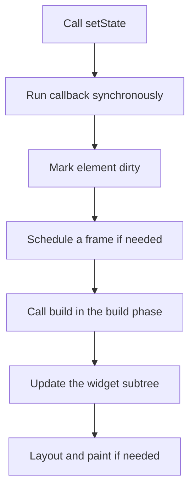

# Flutter™ Interview Questions

A collection of Flutter interview questions and answers for learning and interview preparation.

Flutter and the related logo are trademarks of Google LLC. We are not endorsed by or affiliated with Google LLC.

## 1. What are platform channels?

Platform channels let Dart code communicate with native Android or iOS code, for example to access a device API that is not available through Flutter packages. Messages pass through a named channel and are encoded and decoded using a codec.

## 2. What is the difference between an EventChannel and a MethodChannel?

A `MethodChannel` is for a request and its response: ask the native side to perform an operation and return one result. For example, request the current battery level:

```dart
const batteryChannel = MethodChannel('device/battery');
final level = await batteryChannel.invokeMethod<int>('getBatteryLevel');
```

An `EventChannel` is for a stream of ongoing updates, such as accelerometer readings:

```dart
const accelerometerChannel = EventChannel('device/accelerometer');
final readings = accelerometerChannel.receiveBroadcastStream();
```

The native side registers a handler using the same channel name. A method handler returns one result; an event handler emits values over time.

## 3. What is the difference between the UI thread and the raster thread?

The UI thread runs Dart code to build a frame, including widget building, layout, and paint-command generation. It produces a layer tree. The raster thread takes that tree and renders the frame using Flutter's graphics backend before presenting it. Expensive work on either thread can delay frames, but each thread has a different responsibility; the raster thread is not simply the GPU.

## 4. What types of trees does Flutter use?

- **Widget tree:** Immutable configuration describing the UI.
- **Element tree:** Persistent runtime instances that connect widgets to rendered output and manage lifecycle and state.
- **Render-object tree:** Handles layout, hit testing, and painting.

Flutter also builds a **layer tree** as part of compositing a frame.

## 5. What is the semantics tree in Flutter?

The semantics tree describes the meaning of the UI for accessibility services. It exposes information such as labels, values, roles, and available actions so screen readers and other assistive technologies can interpret and interact with the app. Flutter derives it from semantics information associated with the UI; use `Semantics` widgets when you need to provide or adjust that information explicitly.

## 6. What is tree shaking?

Tree shaking is a build-time optimization that removes code unreachable from the app's entry points. It helps reduce release-build size; it does not generally remove code just because a runtime branch was not taken.

## 7. What are isolates, and how are they different from `compute`?

An isolate is an independent Dart execution context with its own memory and event loop. Isolates do not share mutable objects; they communicate by passing messages. They are useful for CPU-heavy work that would otherwise block the UI isolate.

`compute` is a convenience API that runs a callback with a message and returns its result. On native platforms it runs the work in another isolate. On web, it runs on the current event loop, so it does not provide the same parallel execution.

```dart
final result = await compute(parseJson, jsonString);
```

Use it for substantial CPU-bound tasks, such as parsing a large JSON document—not for small operations where isolate startup and messaging overhead may outweigh the benefit.

## 8. What does composition over inheritance mean in Flutter?

Composition means building functionality by combining smaller widgets rather than inheriting from a widget to reuse its implementation. It makes UI components easier to customize and reuse. For example, `DropdownMenu` uses a `TextField` internally as its menu anchor instead of extending `TextField`:

```dart
DropdownMenu<String>(
  label: const Text('Choose a color'),
  dropdownMenuEntries: const [
    DropdownMenuEntry(value: 'red', label: 'Red'),
    DropdownMenuEntry(value: 'blue', label: 'Blue'),
  ],
  onSelected: (color) => print(color),
)
```

The `DropdownMenu` combines text input and menu behavior; you do not need to create the internal `TextField` yourself.

## 9. What is Impeller, and how does it compare with Skia?

Impeller is Flutter's rendering engine, designed for more predictable rendering performance. It precompiles a smaller set of shaders at engine build time, reducing runtime shader compilation and associated animation jank compared with Skia. It also uses modern graphics APIs such as Metal and Vulkan and can distribute rendering work across threads. Actual performance depends on the device and workload.

As of Flutter 3.50, Impeller is the default on iOS, Android API 29+ with Vulkan support, and desktop platforms. Android devices that do not meet those requirements fall back to the legacy OpenGL renderer; Flutter web currently uses Skia. See the [Impeller documentation](https://docs.flutter.dev/perf/impeller) for current platform support.

## 10. How does `setState` work in Flutter?

`setState` tells Flutter that a `State` object's data has changed and its UI may need updating. It runs the supplied callback synchronously, then marks the associated element dirty so Flutter calls its `build` method in a scheduled frame. Descendants may also rebuild, and layout or painting may follow if needed.

```dart
void increment() {
  setState(() {
    counter++;
  });
}
```



The callback must not be `async`: complete asynchronous work first, then update state inside `setState`. Do not call it after `dispose`; cancel pending work where possible, or check `mounted` after an asynchronous operation before updating state. Multiple calls for the same `State` in one frame do not produce additional rebuilds.

## Flutter resources


[Flutter documentation](https://docs.flutter.dev/)
